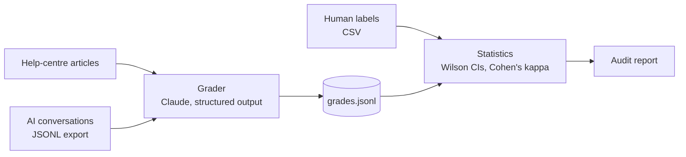

# AgentAudit

[](https://github.com/ektabadiyani/agentaudit/actions/workflows/tests.yml)

**Measure how accurate an AI support agent really is, graded against its own help centre.**

Most AI support dashboards report *deflection*: the share of conversations the bot handled without a human. Deflection counts a confidently wrong answer as a success. AgentAudit grades every AI answer against the company's help-centre articles and reports how often the agent was actually right, with an honest margin of error and a measured check on whether the AI grader itself can be trusted.

On the included sample data, the gap looks like this:

| Metric | Result |
|---|---|
| Deflection rate (what most dashboards show) | 94% |
| Verified resolution rate (kept by the AI, not reopened, *and* graded correct) | 50% |
| Wrong or made-up answers | 35% |

*These figures come from the synthetic sample data, graded with its answer key. See [Sample data](#sample-data).*

## What it produces

A Markdown audit report with:

- **Deflection vs verified resolution**, side by side.
- **Accuracy by topic** (billing, account access, …) with 95% confidence intervals, so small samples aren't over-read.
- **Answers to fix first**: every incorrect or made-up answer, what the customer asked, what the AI said, the claims the help centre doesn't support, and the article to check against.
- **Help articles involved in weak answers**: where the content gaps are.
- **Grader reliability**: agreement between the AI grader and a human on the same conversations, measured with Cohen's kappa, plus every disagreement listed for review.

## How it works



1. **Grade.** Each conversation is sent to Claude with the full help centre in a cached system prompt. Claude returns a structured verdict (validated against a JSON schema), the article ids it relied on, the specific claims it could not support, a one-line explanation, and its confidence.
2. **Verify the grader.** A person grades a sample of the same conversations independently. AgentAudit measures agreement with Cohen's kappa, which discounts the agreement two raters would reach by chance.
3. **Report.** Results are aggregated with 95% Wilson score intervals and written to a Markdown report.

### Verdicts

Each answer gets exactly one verdict. When more than one applies, the first in this list wins:

| Verdict | Meaning |
|---|---|
| `incorrect` | Contradicts a help article (wrong price, wrong steps, a promise the policy doesn't allow) |
| `unsupported` | States a material fact, feature or commitment no article contains, however plausible |
| `partial` | Everything stated is supported, but it leaves out a condition or step the customer needs |
| `correct` | Every material claim is supported and the question is answered |

A handoff to a human is `correct` when the help centre says the request needs staff, and `partial` when the help centre already contained the answer.

### Design decisions

- **The grader only knows the help centre.** It judges against the company's own documentation, not general knowledge, so a verdict is always traceable to an article.
- **Citations are checked.** Article ids the grader cites that don't exist are dropped, so the report never points at a phantom source.
- **Precedence is explicit.** Ordering the verdicts removes the most common source of grader inconsistency: answers that are both incomplete and partly wrong.
- **Failures don't stop a run.** An API error or refusal on one conversation is recorded and the run continues; re-running the same command resumes and grades only what's missing. A bad API key stops the run immediately.
- **Caching keeps cost flat.** The help centre is a cached prompt prefix, so each additional grade pays full price only for the question and answer.
- **No surprise bills.** `grade` estimates the cost and asks before sending anything; `estimate` does the same calculation without grading.
- **Personal data stays home.** Emails, phone numbers, card numbers, national ID numbers and IP addresses are replaced with placeholders before any conversation is sent for grading.

## Quick start

Requires Python 3.12+ and [uv](https://docs.astral.sh/uv/), plus an Anthropic API key.

```bash
uv sync
export ANTHROPIC_API_KEY=...        # or: ant auth login

# See what grading would cost (no API calls)
uv run agentaudit estimate \
  --kb data/sample/help_center \
  --conversations data/sample/conversations.jsonl

# Grade the sample conversations (try --limit 3 first). Shows the estimate and asks before spending.
uv run agentaudit grade \
  --kb data/sample/help_center \
  --conversations data/sample/conversations.jsonl \
  --out runs/sample/grades.jsonl

# Build the report, measuring agreement with the reference labels
uv run agentaudit report \
  --conversations data/sample/conversations.jsonl \
  --grades runs/sample/grades.jsonl \
  --labels data/sample/reference_labels.csv \
  --out runs/sample/report.md
```

Options for `grade`: `--model` (default `claude-opus-5-5`), `--effort` (`low` to `max`, default `medium`), `--workers` (parallel requests, default 4), `--limit`, `--yes` (skip the cost prompt), `--no-redact`.

Cost depends on the size of the help centre and the effort level. For the sample (10 articles, 34 conversations) `estimate` gives roughly $0.24–$1.29 at the default settings. Token counts are approximated offline, so check the usage page in the Anthropic Console after a first run for exact figures.

## Pulling from Zendesk

`pull-zendesk` downloads published help-centre articles and AI-handled tickets into the same layout as the sample data, so `estimate`, `grade` and `report` work on it unchanged.

```bash
export ZENDESK_SUBDOMAIN=acme            # the "acme" in acme.zendesk.com
export ZENDESK_EMAIL=you@acme.com
export ZENDESK_API_TOKEN=...             # Admin Center › Apps and integrations › APIs › Zendesk API

uv run agentaudit pull-zendesk --out data/acme \
  --ai-author-id 123456789 \
  --ai-tag ai_agent \
  --since 2026-09-01
```

| Option | Meaning |
|---|---|
| `--ai-author-id` | The Zendesk user the AI agent posts as. Repeat for several bots. Required. |
| `--ai-tag` | Only tickets with this tag (most AI agents tag the tickets they touch) |
| `--since` | Tickets created on or after this date (default: last 30 days) |
| `--topic-tag-prefix` | Tags like `topic_billing` become the topic `billing` (default prefix `topic_`) |
| `--limit`, `--locale`, `--skip-articles`, `--no-redact` | As named |

How a ticket becomes a conversation:

- **Question:** the requester's public comments before the AI first replied.
- **AI answer:** the AI's public replies before any human agent replied. Anything the AI said after a human stepped in is left out, because it was no longer handling the conversation alone.
- **Handed off:** a human agent replied publicly.
- **Reopened:** the ticket's metrics show a reopen. Zendesk doesn't record when, so any reopen counts.
- **CSAT:** "good" becomes 5 and "bad" becomes 1.

Tickets with no AI reply, or no customer question before it, are skipped and counted. The API token is read only from the environment so it never lands in shell history, rate limits are retried using Zendesk's `Retry-After` header, and the client refuses to follow pagination links to any host other than your Zendesk.

## Input formats

**Help centre:** a directory of Markdown files, one article per file. The file name is the article id; the first `# Heading` is the title.

**Conversations:** JSON Lines, one conversation per line:

```json
{"id": "c02", "topic": "billing", "question": "…", "ai_answer": "…",
 "handed_off": false, "reopened_within_7d": true, "csat": 1}
```

`id`, `question` and `ai_answer` are required. `topic` drives the per-topic breakdown; `handed_off` and `reopened_within_7d` drive the deflection and verified-resolution rates.

**Human labels:** CSV with columns `conversation_id,verdict`. Blank verdicts are skipped, so a half-finished labelling sheet still works.

## Sample data

`data/sample/` contains an invented company, **Tasktide** (a project-management SaaS): 10 help articles and 34 AI conversations written to cover realistic failure modes: wrong refund windows, fabricated discounts, unsafe 2FA resets, password advice that ignores single sign-on, and unnecessary handoffs. `reference_labels.csv` is the verdict each answer was written to have, so it works as an answer key for testing the grader.

No real customer or employer data is included. Regenerate the sample with `uv run python scripts/make_sample_data.py`.

## Tests

```bash
uv run pytest
```

Tests run offline, with no API key or Zendesk account, against fake Claude and Zendesk clients. They cover the statistics, the grader's request shape and error handling, the report, the Zendesk connector (pagination, ticket mapping, rate limits, credentials), personal-data removal, cost estimates, and the rule that `grade` never calls the API without confirmation. GitHub Actions runs them on every push.

## Limitations

- **Accuracy is measured against the help centre, not reality.** If an article is out of date, an answer that matches it is graded correct.
- **Verified resolution is an upper bound.** It relies on the reopen flag; customers who give up without reopening count as resolved.
- **An AI grader can be wrong.** That is why the agreement check exists. Don't rely on the numbers until kappa on a human-graded sample is at least "substantial" (above 0.6).
- **Personal-data removal is pattern-based.** It catches structured identifiers, not names or street addresses written in free text.
- **The whole help centre goes in every prompt.** That suits help centres up to a few hundred articles; larger ones need retrieval to select relevant articles first.

## Roadmap

- [x] Zendesk connector: pull AI-handled conversations and help-centre articles directly via the Zendesk API
- [x] Remove customer personal details before anything is sent for grading
- [x] Cost estimate and confirmation before any API spend
- [ ] Re-run the audit automatically when help articles change (GitHub Actions)
- [ ] Salesforce Service Cloud connector
- [ ] Retrieval for large help centres
- [ ] Web app: connect a helpdesk, run an audit, share the report
